# Dash Essential

Dash Essential is a native hardware-control application for Xiaomi Dash
(POCO X8 Pro Max / Redmi Turbo 5 Max) and its MediaTek Dimensity 9500s
(MT6991) platform.
It combines an Android `NativeActivity`, a Flutter AOT interface, a Rust host
runtime, and a separately privileged Rust daemon. The UI and hardware-control
logic remain native/AOT. A small, framework-only DEX adapter provides the
Quick Settings bypass tile and Android predictive Back callbacks; it contains
no AndroidX, Compose or third-party managed libraries.

The APK never runs as root, does not use the system UID, and does not request
privileged Android permissions. Kernel and vendor controls are owned by the
daemon and reached through authenticated local transports restricted to the
installed application UID.

## Supported target

- Device codename: `dash`
- SoC: MediaTek MT6991 / Dimensity 9500s
- CPU: 8 cores (4× Cortex-A720 + 3× Cortex-X4 + 1× Cortex-X925), 4+3+1
  policies, up to 3.73 GHz
- GPU: Arm Immortalis-G925, 12 cores, up to 1612 MHz
- ABI: ARM64
- Android: API 31 or newer
- Kernel userspace: 16 KB page-compatible native binaries
- Vendor dependencies: Dash touch and display AIDL services plus MediaTek GED

This is device-specific software. Other devices are rejected by the root-module
installer and are not supported by the included AOSP policy.

## Main features

- Four persistent GPU performance profiles with live hardware readback.
- Mali devfreq range, governor, GED boost, power-policy, and OPP controls.
- CPU core mask, independent cluster governors, and validated per-cluster
  minimum/maximum or sustained exact-lock controls sourced from the live kernel
  OPP table.
- UFS scheduler selection across every detected UFS logical unit.
- Touch profiles for 240 Hz native timing, 480 Hz native timing, and the
  original v1.18.0 one-millisecond Android output stream generated from the
  native 480 Hz source.
- Xiaomi touch/display AIDL integration, color modes, expert calibration,
  sunlight mode, HDR/video controls, resolution, and density controls.
- ZRAM size, algorithm, swappiness, compaction, charging, and power telemetry.
- Kernel-supported bypass charging with Immediate or 20/40/80/90% thresholds,
  daemon-owned persistence and measured battery-flow reporting.
- Whole-app hardware-control pause and reset, plus OEM Control defaults for
  touch response and display colour/temperature.
- [System Colors](docs/SYSTEM_COLORS.md): Android Material You seed palettes,
  wallpaper reset, style previews, and capability-based native color readback
  without a HyperOS, ColorOS, or AOSP ROM-name allowlist.
- Daemon-owned persistence and background reassertion after boot, screen wake,
  vendor resets, app force-close, or removal from recents.
- Configurable in-app motion timing with native 120 Hz frame pacing.
- [Per-App Controls](docs/PER_APP_CONTROLS_IMPLEMENTATION.md): foreground touch,
  refresh-rate, CPU and GPU overrides, with saved profiles and global/ROM
  restoration. Starts disabled; system apps are hidden by default.
- [Memory DVFS & UFS](docs/MEMORY_STORAGE_TRIALS.md): supported dynamic ranges,
  exact driver-policy requests and OEM Reset. These are session controls,
  recovered to originals after daemon restart or reboot.
- Bypass Charging Quick Settings/Control Center tile with direct access to
  Charging Control on long-press.

## Screenshots

The redesigned interface groups live device telemetry and hardware tuning into
focused panels for each subsystem.

<table align="center" border="0" cellpadding="8" cellspacing="0">
  <tr>
    <td align="center" style="border: 0;"><a href="docs/screenshots/home-redesigned.png">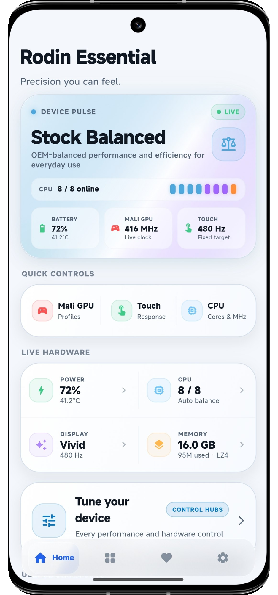</a><br><sub><b>Home</b> - Device Pulse and quick controls</sub></td>
    <td align="center" style="border: 0;"><a href="docs/screenshots/control-hubs-redesigned.png">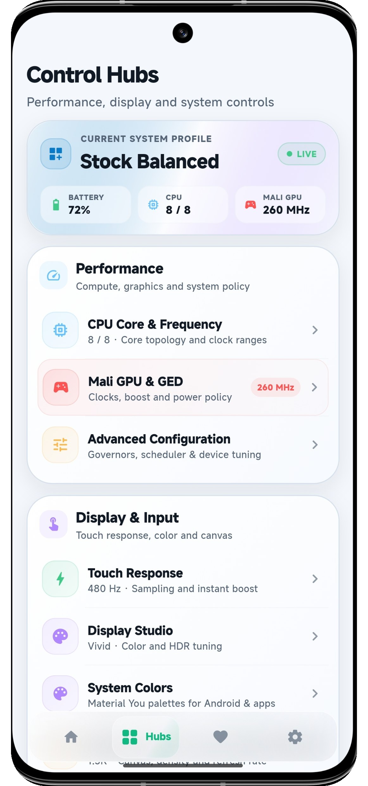</a><br><sub><b>Control Hubs</b> - Hardware subsystem navigation</sub></td>
    <td align="center" style="border: 0;"><a href="docs/screenshots/cpu.png">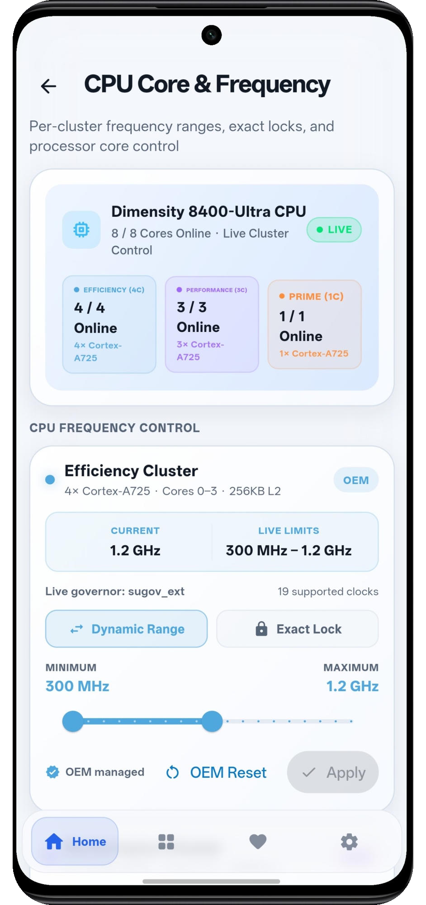</a><br><sub><b>CPU</b> - Core and frequency control</sub></td>
    <td align="center" style="border: 0;"><a href="docs/screenshots/gpu.png">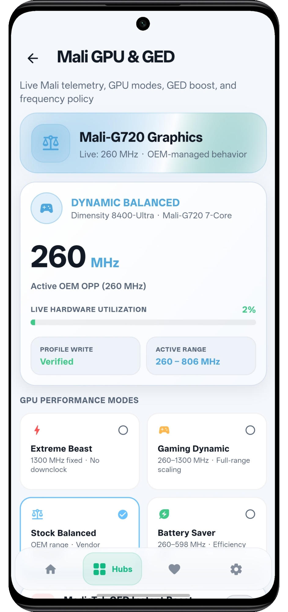</a><br><sub><b>GPU</b> - Mali profiles and GED</sub></td>
  </tr>
  <tr>
    <td align="center" style="border: 0;"><a href="docs/screenshots/touch.png">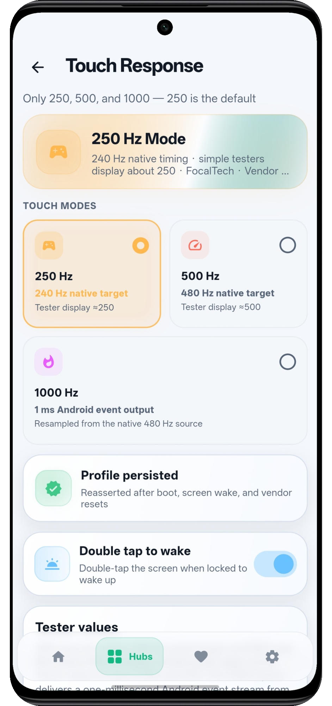</a><br><sub><b>Touch</b> - Response profiles</sub></td>
    <td align="center" style="border: 0;"><a href="docs/screenshots/display.png">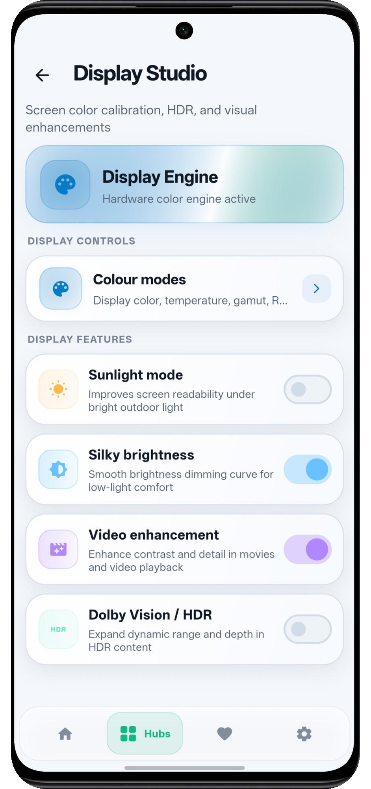</a><br><sub><b>Display</b> - Color and HDR tuning</sub></td>
    <td align="center" style="border: 0;"><a href="docs/screenshots/battery.png">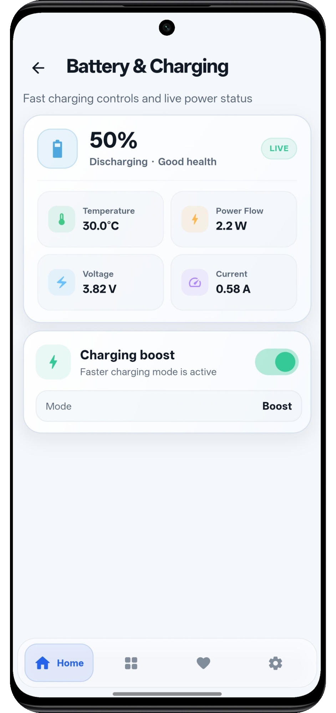</a><br><sub><b>Battery</b> - Charging telemetry</sub></td>
    <td align="center" style="border: 0;"><a href="docs/screenshots/zram.png">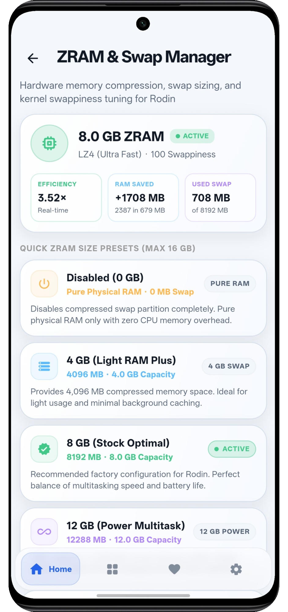</a><br><sub><b>ZRAM</b> - Memory compression</sub></td>
  </tr>
  <tr>
    <td align="center" style="border: 0;"><a href="docs/screenshots/diagnostics.png">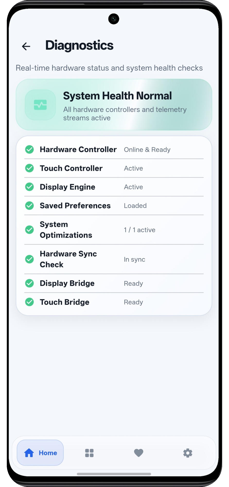</a><br><sub><b>Diagnostics</b> - Runtime health checks</sub></td>
    <td align="center" style="border: 0;"><a href="docs/screenshots/support.png">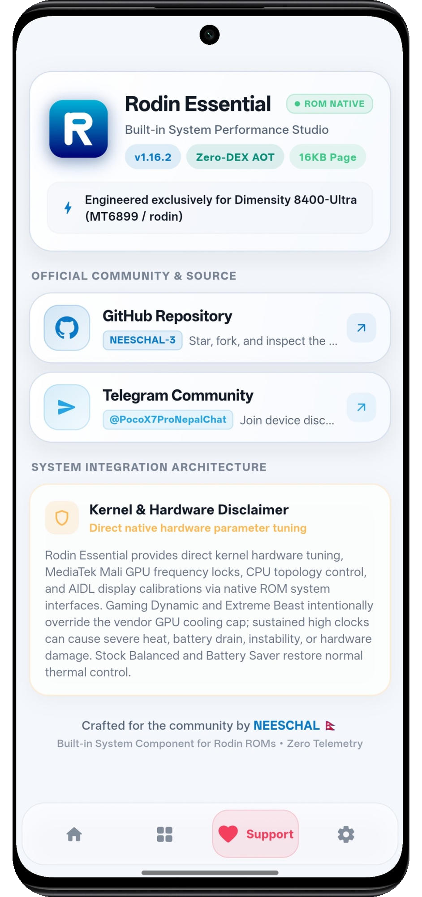</a><br><sub><b>Support</b> - Community and safety information</sub></td>
    <td align="center" style="border: 0;"><a href="docs/screenshots/system-colors.png">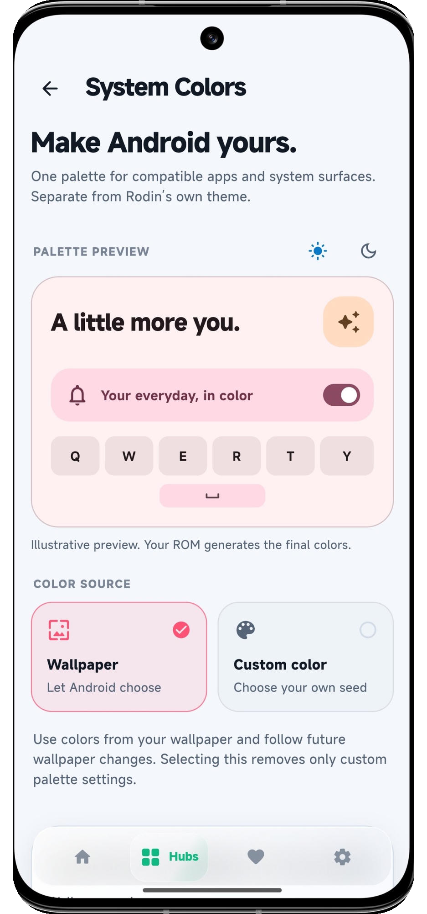</a><br><sub><b>System Colors</b> - Material You palette control</sub></td>
    <td align="center" style="border: 0;"><a href="docs/screenshots/advanced-configuration.png">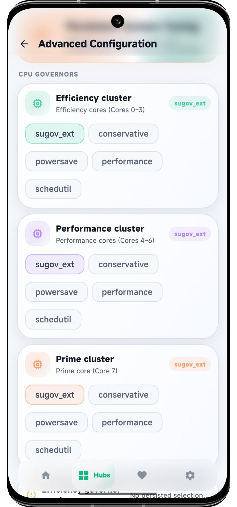</a><br><sub><b>Advanced Configuration</b> - CPU governors and device tuning</sub></td>
  </tr>
  <tr>
    <td align="center" style="border: 0;"><a href="docs/screenshots/resolution.png">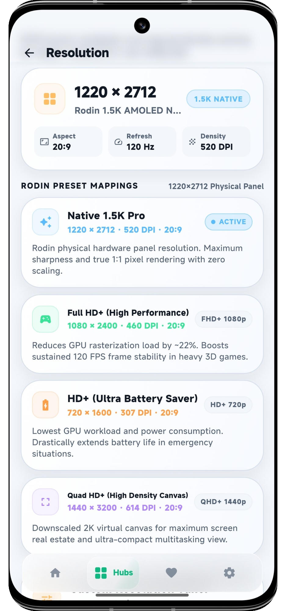</a><br><sub><b>Resolution</b> - Canvas, density, and refresh settings</sub></td>
    <td align="center" style="border: 0;"><a href="docs/screenshots/additional-screen-1.png">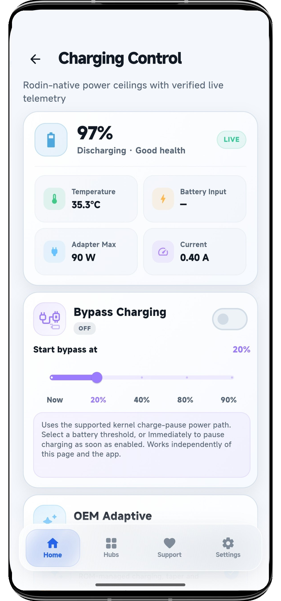</a><br><sub><b>Additional Screen 1</b> - Device configuration</sub></td>
    <td align="center" style="border: 0;"><a href="docs/screenshots/additional-screen-2.png">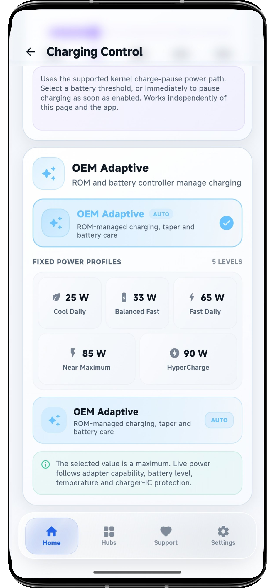</a><br><sub><b>Additional Screen 2</b> - Device configuration</sub></td>
    <td align="center" style="border: 0;"><a href="docs/screenshots/system-colors-updated.png">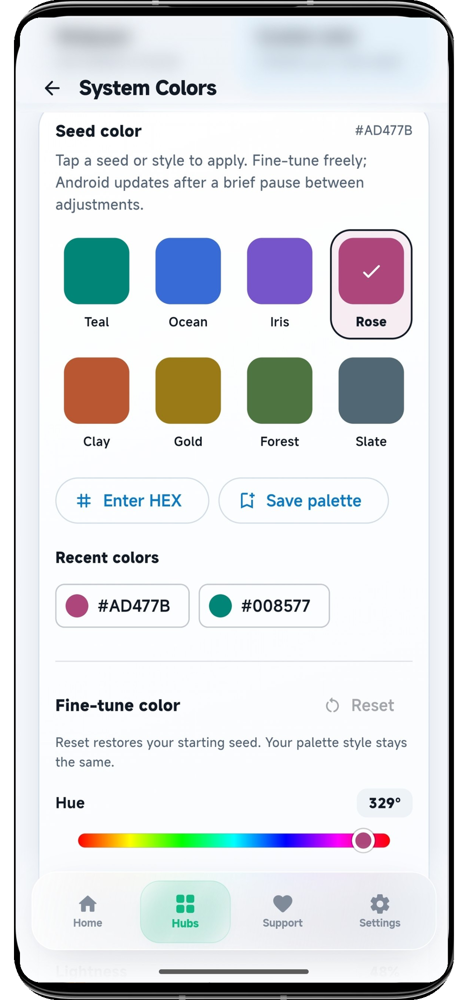</a><br><sub><b>System Colors</b> - Updated palette controls</sub></td>
  </tr>
</table>

## Performance profiles

| Profile | GPU range and governor | GED / power policy | CPU behavior |
| --- | --- | --- | --- |
| Stock Balanced | Vendor-managed 338–1612 MHz, `dummy` | GED off, `coarse_demand` | Unchanged; controlled separately |
| Gaming Dynamic | 338–1612 MHz, `simple_ondemand` | GED on, `always_on` | Unchanged; controlled separately |
| Battery Saver | 338–598 MHz, `powersave` | GED off, `coarse_demand` | Unchanged; controlled separately |
| Extreme Beast | Fixed 1612 MHz, `performance`, DVFS off | GED on, `always_on` | Unchanged; controlled separately |

GPU profiles never modify CPU governors, CPU clock ranges, or CPU core state.
Vendor CPU and platform thermal services remain running in every mode. Gaming
Dynamic and Extreme Beast override the Mali cooling constraint and can still
cause extreme heat, rapid battery drain, instability, or an emergency hardware
shutdown.

Custom CPU ranges remain separate from GPU profiles and governors. While at
least one custom CPU range is active, the daemon selects Dash's OEM
`thermal-nolimits` configuration so Xiaomi's userspace policy cannot replace an
exact lock with a lower ceiling. It keeps the thermal services alive, remembers
the configuration that was active beforehand, and restores it when the final
custom CPU range is reset.

## Integration choices

| Method | APK privilege | Backend | Persistence |
| --- | --- | --- | --- |
| AOSP ROM integration | Normal app UID | Root init daemon | `/data/system/dash-essential/state.conf` |
| KernelSU Next or Magisk | Normal app UID | Root module daemon | `/data/adb/dash-essential/state.conf` |
| Standalone APK | Normal app UID | None | Hardware controls unavailable |

For a ROM release, use the AOSP integration. It installs the APK and daemon in
`/product`, creates a dedicated app SELinux domain, restricts the control socket
to that domain, starts the daemon after boot, and restores saved state without a
root manager.

See [AOSP ROM integration](docs/ROM_INTEGRATION.md) for the complete maintainer
workflow and [Architecture](docs/ARCHITECTURE.md) for runtime details.

## Build from source

Required tools:

- Linux host
- Flutter SDK and revision-matched Flutter engine checkout
- Rust toolchain with `aarch64-linux-android`
- Android SDK, platform 36, build-tools, and NDK r27 or newer
- JDK 17 or newer, `ninja`, `zip`, `unzip`, and standard ELF tools

Build the pinned engine once:

```bash
rustup target add aarch64-linux-android
./tools/build-flutter-engine.sh
```

Build without touching a connected device:

```bash
DASH_BUILD_ONLY=1 ./build-and-install.sh
```

Output is written under `out/release/<timestamp>/`. The build verifies
Flutter analysis, ARM64 AOT output, the restricted platform DEX adapter, APK signing, 16 KB ZIP alignment,
16 KB ELF segment alignment, and a content stamp covering the packaged Flutter
assets and ICU data. If no signing key is supplied, a stable development key is
created once under the ignored `out/signing/` directory and reused by later
local builds.

For release signing, set:

```bash
DASH_KEYSTORE=/absolute/path/release.jks \
DASH_KEY_ALIAS=release \
DASH_KEYSTORE_PASS='store-password' \
DASH_KEY_PASS='key-password' \
DASH_BUILD_ONLY=1 ./build-and-install.sh
```

## Export for an AOSP tree

```bash
DASH_KEYSTORE=/absolute/path/rom-app.jks \
DASH_KEY_ALIAS=dash-essential \
DASH_KEYSTORE_PASS='store-password' \
DASH_KEY_PASS='key-password' \
  ./tools/export-aosp-bundle.sh
```

The generated `dist/aosp/DashEssential-<timestamp>/` directory contains the
APK, daemon, control client, `Android.bp`, init service, split product/vendor
SELinux policy, the APK public certificate used by the dedicated app-domain
mapping, and checksums. Keep the same private key for every ROM update; the
private key is never copied into the bundle.

To build, stage, and wire the integration into an existing ROM source tree in
one command, provide the Dash product makefile and BoardConfig path:

```bash
DASH_KEYSTORE=/absolute/path/rom-app.jks \
DASH_KEY_ALIAS=dash-essential \
DASH_KEYSTORE_PASS='store-password' \
DASH_KEY_PASS='key-password' \
  ./tools/integrate-aosp-rom.sh /absolute/path/to/aosp \
    device/xiaomi/dash/device.mk \
    device/xiaomi/dash/BoardConfig.mk
```

The helper creates `vendor/dash-essential`, verifies the complete build, and
adds the two exact include lines only when absent. It refuses paths outside the
selected source tree and never replaces an existing integration directory.
Passing only the AOSP root keeps the previous stage-only behavior.

## KernelSU Next and Magisk module

For an existing rooted ROM, build the combined application and daemon module:

```bash
DASH_KEYSTORE=/absolute/path/release.jks \
DASH_KEY_ALIAS=release \
DASH_KEYSTORE_PASS='store-password' \
DASH_KEY_PASS='key-password' \
  ./tools/build-kernelsu-next-module.sh
```

Install the ZIP from KernelSU Next Manager or the Magisk app while Android is
running. The installer registers the bundled APK as an ordinary user app and
the module runs only the separate hardware daemon as root. No live SELinux
patch, system overlay, privileged-app conversion, or app-to-root socket rule is
used. The direct Unix transport uses `SO_PEERCRED`. ROMs that block cross-domain
Unix `connectto` use a root-privileged localhost port instead; the app first
proves from its own UID/SELinux context that low-port binding is denied, and the
daemon resolves the accepted client's UID from `/proc/net/tcp` before serving a
command. A daemon-initiated Unix path remains as a compatibility fallback.
Module Action reports which authenticated transport completed instead of
treating a root-only control-client ping as proof. The package uses `skip_mount`;
because it overlays no partition files, KernelSU does not require a metamodule.
Recovery installation is not supported.

Keep the signing key for every future module update. Android rejects an APK
update signed by a different certificate. The first release after the signing
identity reset includes a one-time migration for module installations: it tries
a normal update first and only removes/reinstalls the user application when
Android reports a certificate mismatch. Hardware profiles stored under
`/data/adb/dash-essential` remain intact, while application-local preferences
reset once. Later releases signed by the retained key update normally.

The same ZIP can also act as a temporary update layer over a ROM-native Dash
Essential installation when that ROM APK uses the same signing certificate as
the release APK. The installer updates the app without clearing its data, the
module daemon reuses `/data/system/dash-essential`, and native init is stopped
before the module daemon starts. Removing the module rolls the app back to the
ROM copy and restarts the native service. A differently signed ROM build is
rejected without uninstalling the app or deleting its data; that build must be
updated through its maintainer's OTA or original signing key.

## Repository layout

```text
android/
  aosp/                 AOSP prebuilt, init, and SELinux integration template
  kernelsu-next/        KernelSU Next and Magisk module source
  package/              Manifest and Android resources
  platform/             Minimal Android tile and Back callback adapters
docs/                   Architecture, build, and ROM maintainer documentation
runtime/
  daemon-rust/          Privileged hardware backend and control client
  flutter-engine/       Embedder header and ignored pinned engine prebuilts
  host-rust/            NativeActivity, Flutter embedder, JNI, and IPC bridge
tools/                  Engine, AOSP export, and module build scripts
ui/flutter/             Flutter AOT interface
```

## Documentation

- [Architecture](docs/ARCHITECTURE.md)
- [Building and verification](docs/BUILDING.md)
- [AOSP ROM integration](docs/ROM_INTEGRATION.md)
- [Unpacked EROFS/ext4 ROM integration](docs/UNPACKED_ROM_PORTER_GUIDE.md): Dash-only
  additions and a merge tool using the porter's own ROM policy.
- [Flutter runtime pin](docs/FLUTTER_RUNTIME.md)
- [Commit convention](docs/COMMITS.md)

## Port notes: Rodin Essential to Dash (MT6991)

This tree is a port of [Rodin Essential](https://github.com/NEESCHAL-3/Rodin-Essential)
by **NEESCHAL-3**, reworked for the MediaTek MT6991 `dash` platform by
**afrizal1211**, and carried along the SaanOS line of the same project by
**Saan**. The upstream release it is based on is `v1.18.5`. The upstream
project's licence, copyright notice and release history are preserved;
[NOTICE](NOTICE) lists the modifications.

The port is tested on real hardware by the
[@PocoX8ProMaxID](https://t.me/PocoX8ProMaxID) Telegram community.

The port changed the following. Every value was taken from the shipped dash
kernel, device tree and ROM rather than carried over from MT6899.

### The GPU ladder

The upstream target's Mali-G720 published a uniformly spaced 26 MHz
operating-point ladder, so an OPP index could be computed from a frequency with
a formula. Dash's Immortalis-G925 does not:

- The device tree publishes 52 operating points from 1612 MHz down to 338 MHz,
  and the three lowest entries all report the same 338 MHz.
- The Mali devfreq node advertises 50 frequencies, while the GPUEB's own DVFS
  ladder has 52 slots. The same frequency therefore sits at a different index
  in each: 598 MHz is devfreq index 39 but GPUEB index 49, and 338 MHz is
  devfreq index 49 but GPUEB index 51.

The daemon consequently resolves every operating-point index against the ladder
the driver publishes at `/proc/gpufreqv2/gpu_working_opp_table`, and it
publishes a floor and a ceiling the way MediaTek's own tooling does:
`custom_boost_gpu_freq` carries the ladder position of the requested minimum,
`custom_upbound_gpu_freq` the position of the requested maximum, and the
`gpu_cust_boost_freq` / `gpu_cust_upbound_freq` parameters carry the
frequencies themselves. A request the ladder cannot satisfy is reported as an
error rather than written as a guessed index, because a wrong index moves the
floor to an unrelated frequency.

### Device baselines

| Item | Upstream target | Dash |
| --- | --- | --- |
| GPU devfreq | `13000000.mali` | `48000000.mali` |
| GPU ladder | 260–1300 MHz, 41 uniform steps | 338–1612 MHz, 52 uneven steps |
| Mali cooling device | fixed `cooling_device3` | resolved by type `devfreq-48000000.mali` |
| UFS devfreq | `112b0000.ufshci` | `16810000.ufshci` |
| DVFSRC devfreq | `/devices/platform/soc/1c00f000.dvfsrc/...` | `/devices/platform/1c013000.dvfsrc/...` |
| Backlight | `/sys/class/backlight/panel0-backlight` | `/sys/class/leds/lcd-backlight` |
| Native resolution | 1220 x 2712 | 1280 x 2772 |
| Touch panel | Goodix / FocalTech | Novatek NT38771 |

The CPU cluster layout is unchanged: Dash exposes the same 4+3+1 policy
numbering (`policy0`, `policy4`, `policy7`) with eight cores.

### Thermal ownership

Dash's thermal interface is the same one the upstream target used, including
the `thermal_message/sconfig` configuration mode that suppresses the vendor's
competing CPU policy while a custom CPU range is held. The vendor thermal
services stay running in every mode.

### The platform's GPU ceiling

Dash's ladder has a plateau. Its 24 middle slots all report 1430 MHz, so a
1430 MHz floor resolves to the last of them and a 1430 MHz ceiling to the
first, and both name the same clock. The MediaTek firmware's own `THERMAL_EB`
row caps at the first of those slots, so the firmware's thermal ceiling is
1430 MHz even though the ladder's top operating point is 1612 MHz.

That ceiling **cannot be raised from software.** The limit table the thermal
framework arbitrates through is read-only on this ROM, and the platform's
power service holds the GPU at or below 1430 MHz regardless. The app
therefore reports the cap rather than fighting it: a profile whose own writes
landed is shown as *armed and capped by THERMAL_EB*, with the effective
ceiling read from the driver, and it is not re-applied on every tick.

The effective ceiling is read twice, because the driver publishes it twice:
as an index in the power policy status dump, and directly in hertz in
`/sys/kernel/thermal/gpu_info`. The second form is simpler and does not need
the status dump to be read whole.

### Known differences

- Dash's stock kernel publishes no bypass-charging node, so the bypass-charging
  feature reports itself as unsupported rather than pretending to provide
  direct power. The charge-current limit is still available: dash exposes
  `constant_charge_current` on the battery power supply.
- The charge-current tiers follow the upstream calibration. The absolute
  ceiling comes from the vendor charger configuration, which is not part of the
  public ROM dump, so it should be confirmed against the target hardware; the
  daemon verifies every write against its readback and reports a clamped or
  rejected value instead of pretending it applied.

## License

Licensed under the Apache License, Version 2.0. See [LICENSE](LICENSE).
